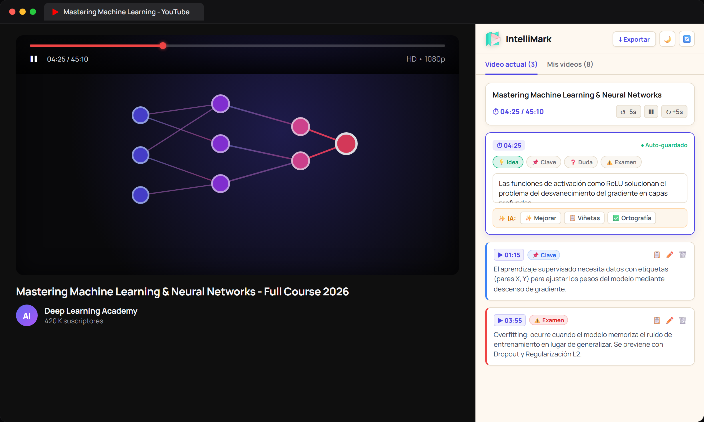

<p align="center">
  
</p>

<h1 align="center">IntelliMark</h1>

<p align="center">
  <strong>Convierte videos de YouTube en apuntes de estudio estructurados con timestamps, asistencia de IA y exportación profesional.</strong>
</p>

<p align="center">
  <a href="#-características-principales">Características</a> •
  <a href="#️-instalación-en-modo-desarrollador">Instalación</a> •
  <a href="#-atajos-de-teclado-globales">Atajos</a> •
  <a href="#-stack-tecnológico">Stack</a>
</p>

<p align="center">
  
</p>

---

## ✨ Características Principales

- **Captura con Timestamp Exacto:** Al presionar `Alt + Shift + N` o el botón *"Nueva nota"*, se congela el segundo del video para que tomes notas sin perder el hilo.
- **Pausa Automática Inteligente:** El reproductor de YouTube se pausa al iniciar una nota para no perder detalles, permitiéndote reanudarlo cuando desees.
- **Salto en el Tiempo con Auto-Play:** Haz clic en el botón de tiempo de cualquier nota (ej. `▶ 03:45`) y el video saltará instantáneamente al momento exacto e iniciará la reproducción.
- **Chips de Clasificación Rápida:** Organiza tus apuntes con etiquetas de un solo toque: `💡 Idea`, `📌 Clave`, `❓ Duda` y `⚠️ Examen` con bordes visuales temáticos.
- **Copia al Portapapeles en 1 Clic:** Copia apuntes individuales al instante para pegarlos en Notion, WhatsApp o tu documento de estudio.
- **Asistente de IA Automático (Groq):**
  - **✨ Mejorar:** Clarifica ideas y redacta apuntes concisos con animación de resplandor (*shimmer*).
  - **📋 Viñetas:** Estructura notas dispersas en listas de puntos clave.
  - **✅ Ortografía:** Corrección gramatical y sintáctica automática.
  - **Arquitectura Transparente:** Conectado mediante microservicio seguro sin necesidad de configurar claves API.
- **Persistencia de Borrador:** Si cambias de pestaña o cierras el panel, el apunte que estés escribiendo se guarda automáticamente y se restaura sin perder ni una letra.
- **Historial con Búsqueda:** Consulta tus videos anteriores en la pestaña *"Mis videos"* y filtra rápidamente por título.
- **Exportación Dual Profesional:**
  - **Microsoft Word (.docx):** Documentos elegantes con portada, metadatos y tabla de notas con enlaces clickeables a YouTube.
  - **Markdown (.md):** Formato limpio listo para importar a Obsidian, Notion o tu editor preferido.
- **⚡ Integración Opcional con Intellixy:** Conecta tu cuenta mediante login directo para enviar tus apuntes de YouTube a cualquier materia y generar Flashcards de repaso y Quizzes automáticos con IA en [intellixy-web.vercel.app](https://intellixy-web.vercel.app).
- **Diseño Editorial:**
  - Tipografía geométrica **Manrope** empaquetada localmente.
  - **Modo Claro** con fondo cálido editorial (`#FEF8F0`).
  - **Modo Oscuro** de alto contraste en tonos azul noche.
- **100% Privado y Local:** Todos tus apuntes se guardan en tu disco local mediante `chrome.storage.local`.

---

## 🛠️ Instalación en Modo Desarrollador

1. Clona el repositorio:
   ```bash
   git clone https://github.com/bleidys16/IntelliMark.git
   cd IntelliMark
   ```

2. Instala dependencias y compila:
   ```bash
   npm install
   npm run build
   ```

3. Cargar en Chrome:
   - Abre tu navegador y dirígete a `chrome://extensions/`.
   - Activa el **Modo de desarrollador** (esquina superior derecha).
   - Haz clic en **Cargar descomprimida** (*Load unpacked*).
   - Selecciona la carpeta `dist/` generada en el proyecto.
   - Fija el ícono de IntelliMark en tu barra de herramientas.

---

## ⌨️ Atajos de Teclado Globales

| Atajo | Acción |
| :--- | :--- |
| `Alt + Shift + P` | Abrir o cerrar el Side Panel de IntelliMark |
| `Alt + Shift + N` | Pausar video y crear nota rápida en el timestamp actual |
| `Enter` (en editor) | Guardar nota |
| `Shift + Enter` | Salto de línea |
| `Esc` | Cancelar edición |

---

## 🏗️ Stack Tecnológico

- **Framework:** React 19 + TypeScript
- **Bundler:** Vite 6 + `@crxjs/vite-plugin`
- **Iconografía:** Lucide React
- **Tipografía:** `@fontsource/manrope`
- **Exportadores:** `docx` & `Blob API`
- **IA Engine:** Groq SDK / Llama 3.3 70B & Microservicio Hono en Cloudflare Workers
